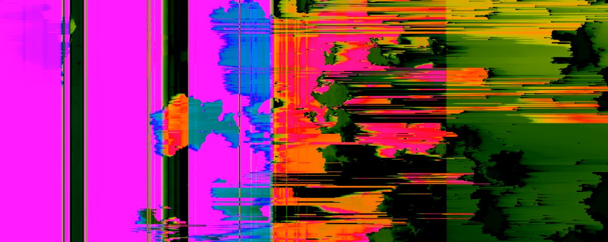
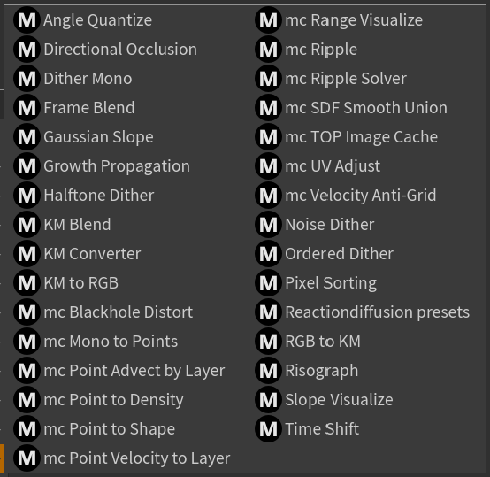

# MotionCOPs

Ready-to-use tools for Houdini Copernicus, built in daily production by [Bo-Ning Li](https://boningli.com).

## Recent practical features

- **Batch media paste** — **Ctrl+V** images and videos straight into COPs. [Details](docs/media-paste.md)
- **LUT grading** — apply `.cube` LUTs and adjust their intensity. [Example](Example_LUTs.hiplc)
- **2D → 3D volumes** — stack animated images into volumes, with a CPU sparse VDB option.

**Houdini 21 & 22** · [Install MotionCOPs](#installation) · [Project page](https://boningli.com/rnd/motion-cops)

**Inside:** organic growth · stylization · dithering & risograph · glitch · Kubelka-Munk color · SOP ↔ image bridges · time & caching utilities

## Work made with MotionCOPs

MotionCOPs is built through production. Each piece below was made primarily with tools from the library; all visual work shown is my own. The toolkit and the images evolved together across commissioned installations, large-format screen work, and self-directed studies.

  
   
  <strong>Edge-of-Chaos Fluid</strong> — the project cover and a key production study: a reusable Copernicus fluid system developed with MotionCOPs workflows.

<table>
  <tr>
    <td width="50%" valign="top">
      
       
      <strong>23.Springs / Granite Properties</strong> — MotionCOPs-driven image processing and procedural distortion for a permanent 8K installation.
    </td>
    <td width="50%" valign="top">
      
       
      <strong>OFFF Barcelona Screen</strong> — the fluid system adapted through MotionCOPs for a large-format façade projection.
    </td>
  </tr>
</table>

  
   
  <strong>Field study / GitHub banner</strong> — a panoramic simulation study developed with MotionCOPs field-processing tools.

  
   
  <strong>Fluid-field study</strong> — a finished image from the same production-tested Copernicus workflow.

<table>
  <tr>
    <td width="50%" valign="top">
      
       
      <strong>Contour study I</strong> — feedback, edge analysis, and repeated line structures generated in MotionCOPs.
    </td>
    <td width="50%" valign="top">
      
       
      <strong>Contour study II</strong> — a second parameter state from the same procedural system.
    </td>
  </tr>
</table>

## Toolkit at a glance

> Supports Houdini 21 & 22. Jump to [Installation](#installation).

---

## Showcase

### Swirl

### Growth Propagation

Generate organic spreading patterns — cellular growth, lightning, cracks, veins, and DLA-style structures. Supports directional fields and attractors for precise control. Inspired by Nick Taylor's Aelib, reimagined for COPs.

  

### Ripple

GPU-based ripple simulation for water surfaces, shockwaves, and reactive wave patterns — driven by `mc Ripple Solver` directly inside the Copernicus network.

### Analysis

Slope, occlusion, and SDF tools treat images as fields rather than pixels — useful for terrain-style studies, directional lighting, and fractal growth structures.

  

### Pixel Sorting

GPU-accelerated pixel sorting for glitch art, flowing textures, and stylized transitions. Mask by luminance or custom input, with built-in growth animation.

### Risograph

Instant risograph print aesthetic built on Kubelka-Munk color theory — real ink mixing, not RGB filters. Three modes: organic, halftone, or digital.

  

---

## Tool Catalog

### Simulation & Growth
Growth Propagation · Reactiondiffusion Presets · Copernicus Solver *(SOP)*

### Dithering & Stylization
Risograph · Halftone Dither · Ordered Dither · Noise Dither · Dither Mono · Pixel Sorting

### Analysis & SDF
Gaussian Slope · Slope Visualize · Angle Quantize · Directional Occlusion · mc SDF Smooth Union

### Image Distortion & FX
mc Blackhole Distort · mc Ripple · mc Ripple Solver · mc Velocity Anti-Grid

### Point ↔ Layer Bridge
mc Mono to Points · mc Point to Density · mc Point to Shape · mc Point Velocity to Layer · mc Point Advect by Layer

### Time & Caching
Time Shift · Frame Blend · Cache · mc TOP Image Cache

### Utility
mc UV Adjust · mc Range Visualize · mc Flow Block Begin / End

### Kubelka-Munk Color Science
RGB to KM · KM to RGB · KM Converter · KM Blend

---

## Installation

1. Download and extract the repository to any location
2. In your Houdini home directory (e.g. `C:/Users/MY_USER/Documents/houdini22.0`), create a `packages` folder if it doesn't exist
3. Copy `MotionCOPs.json` into `packages/`
4. Edit the JSON file — set the path to your MotionCOPs directory

See the [Houdini docs](https://www.sidefx.com/docs/houdini/ref/plugins.html) for more on package files.

### Paste images and videos into COPs

Copy files, then **Ctrl+V** in a COPs network; **Ctrl+Z** undoes the batch.
See the [media paste guide](docs/media-paste.md) for details and checks.
